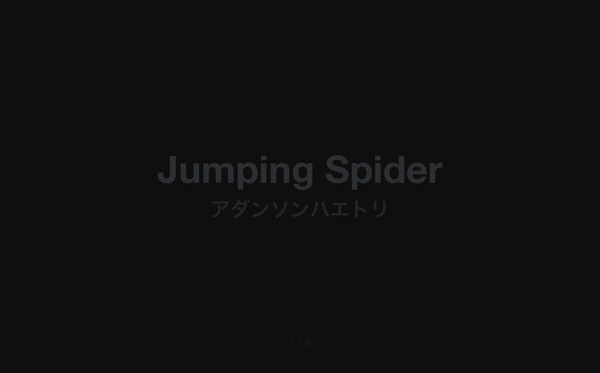
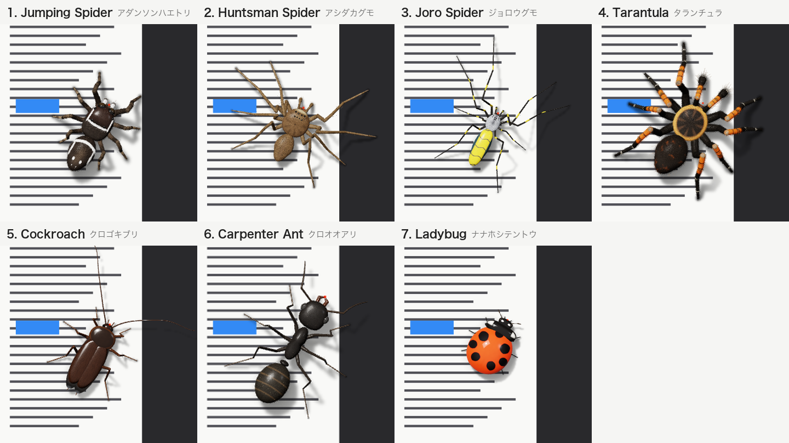
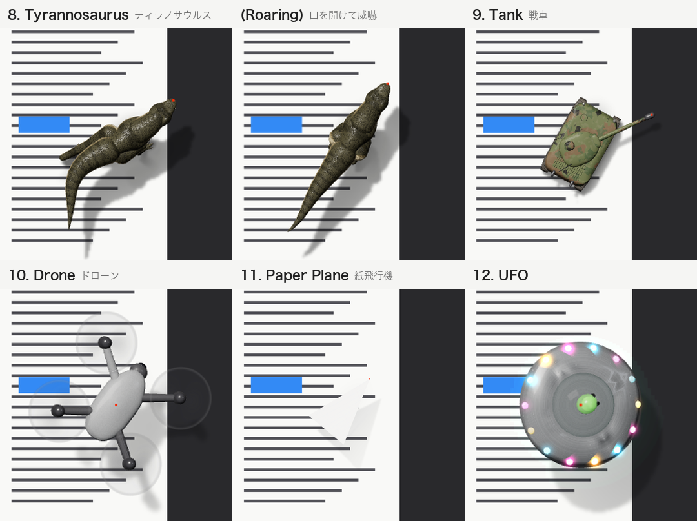

# Mushi Cursor 虫カーソル

Turn your Mac's mouse cursor into a hyper‑realistic bug, a dinosaur, or a vehicle — 12 kinds in all.
They walk, jump, fly, and react when you click.

Mac のマウスカーソルを、本物そっくりの虫や恐竜・乗り物にするアプリです（全12種）。
歩いたり跳んだり飛んだりし、クリックするとアクションを起こします。



▶️ [Full‑quality video (MP4) / 高画質の動画](docs/demo.mp4)

### All 12 / 全12種




---

## English

### Requirements
- macOS 14 or later, **Apple Silicon** Mac
- Xcode Command Line Tools (`xcode-select --install`) — the app is built from source on your Mac

### Install & run
```bash
git clone https://github.com/chattan-mk/mushi-cursor.git
cd mushi-cursor
./build.sh                      # builds ~/Applications/虫カーソル.app
open ~/Applications/虫カーソル.app
```
Or just double‑click `はじめる.command` (start) / `おわる.command` (quit).

### Controls
| Key | Action |
|---|---|
| `⌘⌥D` | Next creature (`⇧⌘⌥D` = previous) |
| `⌘⌥S` | Hide / show the creature (back to the normal arrow) |
| Menu bar spider icon | Choose creature, size, actions, launch at login, quit |

The click point is the **tip of the creature's head**. Click = pounce / bite / fire, right‑click = web, wings, roar, machine gun, etc.

> While the app runs it temporarily takes over `⌘⌥D` (normally “toggle Dock hiding”) and restores it on quit.

### Creatures
1. Adanson's jumping spider · 2. Huntsman spider · 3. Joro spider · 4. Tarantula · 5. Cockroach · 6. Carpenter ant · 7. Ladybug · 8. Tyrannosaurus · 9. Tank · 10. Drone · 11. Paper plane · 12. UFO

### How it works
Native Swift + Metal. A transparent, click‑through full‑screen window sits on top and a small Metal layer follows the cursor. Every creature is rendered in 3D each frame (procedural meshes, per‑joint leg IK, whip‑like antennae, shell‑method hair, projected soft shadows). The real arrow is hidden with WindowServer's private `SetsCursorInBackground` setting and comes back automatically when the app quits or crashes.

### Limitations
- Over the Dock, macOS forces the normal arrow to show.
- Cursor shape changes (e.g. the text I‑beam) are not shown.

---

## 日本語

### 必要なもの
- macOS 14 以降・Apple シリコンの Mac
- Xcode コマンドラインツール（`xcode-select --install`）。手元でソースからビルドします

### 使い方
- **起動**: `はじめる.command` をダブルクリック（初回は自動でビルドして `~/Applications/虫カーソル.app` に入れます）
- **終了**: `おわる.command`、またはメニューバーのクモ → 終了
- **虫をしまう／出す**: `⌘⌥S`
- **生き物を切り替える**: `⌘⌥D`（`⇧⌘⌥D` で前に戻る）

クリックする位置は **頭の先端（牙・大あごの先）** です。

> `⌘⌥D` は macOS では「Dock を自動的に表示/非表示」のショートカットです。このアプリが動いている間だけ止め、終了すると元に戻します。

### 生き物（⌘⌥D の順）
1. アダンソンハエトリ … 速く動かすと跳ぶ。右クリックで網を張る
2. アシダカグモ … 長い脚で走る
3. ジョロウグモ … 黄色と青黒の縞
4. タランチュラ（メキシカンレッドニー）… 毛むくじゃら、オレンジの膝
5. クロゴキブリ … 速く動かすと翅を広げて飛ぶ
6. クロオオアリ … 右クリックで蟻酸を吹く
7. ナナホシテントウ … 速く動かすと鞘翅を開いて飛ぶ
8. ティラノサウルス … 足あとが残る。クリックで噛みつき、右クリックで咆哮
9. 戦車 … キャタピラの跡。クリックで主砲、右クリックで機銃
10. ドローン … クリックで急降下、右クリックで宙返り
11. 紙飛行機 … 止まると画面に着地。クリックで横回転
12. UFO … クリックで牽引ビーム、右クリックでワープ

### しくみ
Swift + Metal のネイティブアプリ。クリックが素通りする透明な全画面ウインドウを一番上に置き、カーソルの位置で生き物を毎フレーム 3D 描画しています（形状関数のメッシュ、関節ごとの脚 IK、シェル法の毛、投影した影）。本物の矢印は WindowServer の非公開設定 `SetsCursorInBackground` で隠し、終了・クラッシュ時は自動で元に戻ります。

### 開発用
- `./build-dev.sh` → `build/mushi-dev --snapshot 出力先 [--species 0〜11]` … 画面を使わずに PNG に書き出す
- `~/Applications/虫カーソル.app/Contents/MacOS/MushiCursor --demo` … 自動デモ

## License
MIT
